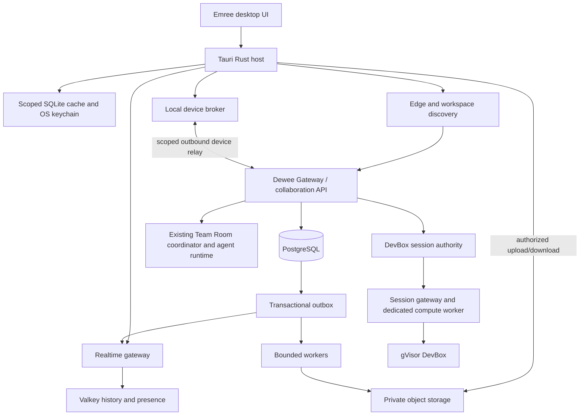

# System architecture

## System boundaries

Emree is a desktop client, not a standalone multi-agent platform. Use Dewee's authoritative contracts. A new native collaboration module belongs to the Dewee service; an adapter invokes the existing Team Room orchestration path. A dedicated realtime transport is a delivery plane, never a second authorization authority. Device control and DevBox execution use separate brokers; neither is a chat message side effect.



Arrows represent logical interactions; database commits, job processing and authorizations are detailed in [contracts](CONTRACTS.md), [realtime](REALTIME.md), [DevBox](DEVBOX.md) and [Computer Use](COMPUTER-USE.md). No implicit permission flows through the diagram.

## Ownership and planes

| Domain | Authority | Emree responsibility |
| --- | --- | --- |
| Users/workspaces/membership/roles | Dewee identity and policy | Display, scoped login, workspace selection |
| Rooms/messages/events/read state | Dewee native collaboration module | Projections, pending sends, offline cache |
| Agent runtime, tasks, knowledge, approvals | Existing Dewee services | Link and render authorized representations |
| Realtime | Transport provider + Dewee subscription authorization | Reconnect, replay, dedup |
| DevBox resources and sessions | Dewee and worker controller | Workbench renderer, scoped session input |
| Local device grants | Dewee policy AND broker/OS consent | Native trust UI and visible status |
| Extension catalog | Approved registry/operator policy | Local verify, install, enable, dispose |
| Attachments | Dewee metadata/ACL + storage provider | Authorized transfer and preview |

### Native rooms vs existing Team Room

Existing channel-derived rooms coordinate agent membership for an external conversation. Native rooms have human and agent participants with stable IDs and ACL. Do not mutate the old room constraints to shoehorn human members. Add collab rooms/members/messages/events/read-state/outbox; bind native room to coordinator using a typed adapter and explicit identity domain. Native messages become durable first; orchestration is a separate job. External channels are not automatically synced to native rooms; explicit binding, visibility rules, echo dedup, grants and failure behavior are required.

## Native onboarding and identity

See [ONBOARDING.md](ONBOARDING.md): use a first-party native OIDC client and separately audience-bound desktop session, then canonical workspace provisioning, setup plan and readiness. SSO access tokens are not API tokens. Do not duplicate identity/setup state. Hosted and self-hosted capabilities differ.

## Federation-ready collaboration

See [FEDERATION.md](FEDERATION.md): room ownership/home cell and issuer-qualified principals/resources in initial contracts; native local rooms remain default. Shared contexts use explicit bilateral relationships and resource-owner grants, not foreign tenant membership. Same-cell first, cross-cell relay later. Single authority per room, no global database or implicit cross-workspace access.

## Client layout

- Local bundled React 19/TS/Vite shell, accessible design system, TanStack Query for server state, Zustand for transient UI state. Virtualized message timeline; ProseMirror/Tiptap candidate for composer; sanitized content.
- Rust host (Tauri 2) owns login/refresh, allowlisted IPC, typed Dewee client, OS keyring, network, scoped local persistence, update verification, file dialogs, notification bridge. No untrusted remote pages with privileged IPC.
- Device broker separate least-privilege process with OS-native adapters; authenticated local IPC, constrained command types, consent UI owned by trusted host, process lifecycle supervised. Isolation must be tested; separate process alone is not a sandbox.
- Workbench is first-party plugin with right sidebar, session tabs and xterm.js plus semantic chat. Runtime adapter execution resides in Dewee worker/guest, not renderer.
- Extension host owns registrations, dependency graph, lifecycle, typed events, UI slots. Core auth, storage policy, safety controls and updater cannot be replaced by plugins.

## Repository layout (target, not present yet)

```text
apps/desktop/src/             React shell and feature surfaces
apps/desktop/src-tauri/       native host and capability declarations
crates/dewee-client/          typed transport/auth abstraction
crates/sync-engine/           cursor and pending-send state machine
crates/local-cache/           encrypted/policy-aware cache
crates/device-broker/         broker process and grants
crates/os-adapters/           platform-specific provider traits/adapters
crates/protocol/              generated wire types and validation
packages/ui/                  accessible design system
packages/contracts/           generated TS types
packages/extension-sdk/       manifest, registry, typed APIs
extensions/                   official modules, example bundles
contracts/                    canonical schemas, fixtures and version rules
tests/                        e2e, fault, contract, benchmark fixtures
packaging/                    installers, release metadata
docs/ and plans/              specifications and phase plans
```

Start with a thin shell, one SDK package and one sync crate; extract modules as ownership boundaries become real. No empty scaffolding or microservices merely to match this tree.

## Stack and evolution

Tauri 2/Rust and React/TS are preferred pending a cross-platform spike. PostgreSQL 18 (match deployed supported Dewee), SQLite local, Go HTTP collaboration in Dewee, Centrifugo/Valkey candidate realtime, PostgreSQL outbox first; NATS JetStream only when justified. R2/S3 private objects, FFmpeg/libvips sandboxed media, FTS first with optional pgvector. Edge may be Cloudflare; self-hosted works without it. Keep protocol DTOs versioned and language-neutral, generate types from shared contract fixtures. Keep SDK and broker narrowly typed. No arbitrary remote native command bridge.

## Failure isolation

AI provider outage does not block human messages. Realtime outage does not undo committed data; client reconciles through API. Cache loss forces authoritative fetch; cache cannot grant rights. Storage outage blocks new attachments only. DevBox failures affect sessions, not messaging. Revocation and emergency stop use an independent priority lane; never wait behind model jobs. Per-cell admission and quotas prevent noisy neighbors. See security spec for boundaries.

## Decision records

The decision IDs in [DECISIONS.md](../DECISIONS.md) are the initial ADR register. Each new irreversible change should have its own ADR under [adr/](adr/README.md) and evidence in the implementation plan. Do not claim implementation from this design.
