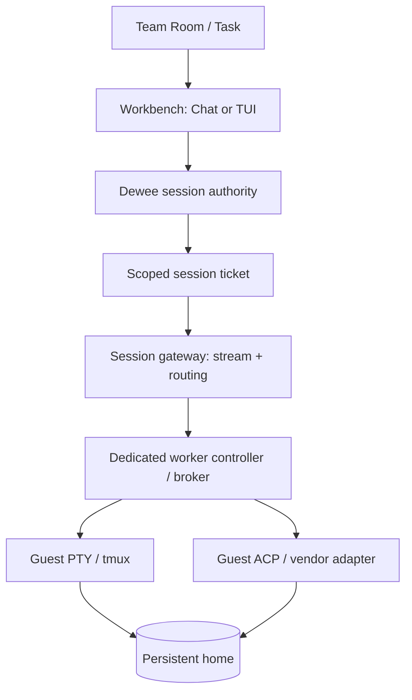

# DevBox Workbench

## Product intent and existing foundation

The official Emree Workbench extension opens a resizable right sidebar beside the conversation. Users select a permitted DevBox, runtime and session, control a remote coding agent using native TUI or structured Chat UI, and share selected outcomes back to a Team Room. No compute is performed by the desktop WebView.

The Dewee DevBox design already exposes lifecycle, versioned initial/wakeup scripts, resource presets and managed runtimes on an isolated Docker/gVisor backend. The documented baseline supports Claude Code, Codex, Pi and Antigravity (agy); add DSH after compatibility and vendor terms tests. Persistent home (/home/dev) survives compute replacement; root is read-only. Disk quotas, resize, snapshots, auto-sleep and interactive terminal must not be represented as available until upstream implements them. Recheck capability discovery against the running deployment, not just a build version.

## User journey

Open Workbench from a room header or task card -> select box -> see current state/permissions -> explicit wake if needed -> choose existing session or create new -> select supported mode/runtime -> interact -> detach/reattach or explicitly cancel/terminate -> optionally share authorized diff/artifact/result. Sidebar tabs preserve per-session state; resize, maximize, pop out to a separate trusted window; navigate chat without killing work. Sleep/recreate invalidates interactive processes; home files remain, session runtime resume only where proven. Closing UI detaches, not stop. Admin can see resource status without automatically gaining access to private terminal content.

## Two modes, one session registry

| Mode | Transport and renderer | Guarantees |
| --- | --- | --- |
| TUI/shell | Remote PTY over binary WebSocket; xterm.js + fit addon | Raw ANSI, UTF-8, keyboard, resize and interrupts, bounded scrollback, attach/detach |
| Structured chat | ACP JSON-RPC or vendor SDK/RPC adapter in guest | Typed messages, tool progress, approval, artifacts, cancellation, session resume if supported |

Do not scrape TUI output into authoritative chat events. No universal live TUI/chat switch: session compatibility per runtime; if unsupported create separate session and show explanation. Runtime table is a target: Claude Code TUI + ACP/SDK adapter; Codex TUI + ACP/app-server adapter; Pi TUI + RPC adapter; Antigravity verify interactive/protocol support; DSH ACP profile (dsh --profile acp), TUI only if verified. Runtime version/capabilities returned by discovery, not hardcoded UI.

## Server and worker responsibilities

Dewee owns lifecycle operations, membership, policy, sessions and metadata; session gateway routes authenticated connections; dedicated worker controller alone owns backend credentials and invokes the exact isolated container. Guest runtime output and filesystem are adversary-controlled. Never run a tool bridge on Gateway host on behalf of a guest. No raw Docker socket, public SSH, cluster/master tokens or host paths in the guest; no runc fallback. Worker placement pinned to persistent volume; backup/migrate explicitly. gVisor remains first backend; KVM alternative only after availability and isolation evidence.

Use distributed lease/fence per box and compute generation, aggregate resource admission and disk quota (not declared size only). Long wake/install/script operations become durable jobs with progress, cancellation and unknown outcome reconciliation. Idle sleep only after policy idle interval AND no active runs, sessions, control leases or pending operation. Confirm destructive operations; backups before supported destructive paths. No claim of snapshots before implementation. Separate generation-bound execution/session process authority from collaborative metadata.

## Session contract (proposed)

Session record: tenant, box ID, session ID, compute generation, owner principal, runtime/mode/version, working directory ref, task/run/room refs, state, timestamps, policy epoch, controller lease generation. States: created, starting, ready, running, waiting_approval, detached, terminating, exited, failed, unknown. Detach describes attachment state, not process exit; model process lifecycle separately. Terminal attachment has read scope or exclusive input lease; watcher access explicit. Revoke stops new input immediately, closes stream, cancels or terminates process according to policy; cannot undo effects already committed. Recreate, stop, worker fence or generation change invalidates tickets and sessions.

Candidate routes under /v1/devboxes/{id}:
- GET /capabilities, GET/POST /sessions, GET /sessions/{sid}
- POST /sessions/{sid}/ticket, /prompt, /cancel, /terminate, /takeover, /release
- GET /sessions/{sid}/changes, /artifacts, /events?cursor=...
- POST /previews, GET /operations/{opId}

Ticket short-lived, one-time attach or explicit bounded renewal, audience, tenant, actor, box/session, generation, mode and read/control scopes, policy epoch; no token in URL/log. Authenticate each attach and recheck authorization before input/side effect, with lease expiry/fencing. CLI/MCP parity for authorized operations (see integration spec); do not expose unrestricted generic host command tool.

## Terminal streaming

Use Docker exec TTY/hijacked stream or equivalent verified adapter from worker. Install tmux only after actual gVisor test; tmux persistence ends with container stop. Separate session WS from collaboration; binary data with stream sequence/offset, max frame/buffer size, flow-control credits/ACK, resize (bounded rows/cols), input, signal and close controls. Use one active input controller, observers read-only; race/fence test concurrent attach. Keep bounded replay/screen checkpoint; if insufficient, reattach/redraw with explicit gap indicator. xterm.js onWrite callbacks drive credit; disable unsafe OSC clipboard/links, confirm external link opens, sanitize nonterminal display. No automatic replay of keyboard input or uncertain command. Do not retain raw transcript by default. High-volume output cannot starve room messages or revoke commands.

## Structured coding chat and context

Runtime adapter starts inside guest with minimum allowed env/cwd. ACP process/SDK transport streams typed deltas, safe tool state, requests and final result; use structured protocol not private chain-of-thought. Map to conversation nodes and existing Dewee trace/interaction services. Permission request includes exact action/hash, expected scope/expiry, current authority; cancel or timeout blocks execution. Runtime tools for filesystem/terminal must be guest-bound. Same context only when user explicitly shares permitted task/room resources; no broad history injection. Keep task->session->run->artifact references and trace ID. Publish user-approved result/diff to room; raw logs, credentials and private conversation stay private.

## Trust model, accounts and preview

One guest is one trust domain. Personal box holds one principal's credentials; shared box uses explicit organization service identity, not several users' personal logins. Read-only observer is not a shell user; sharing terminal input permits arbitrary actions within the guest and must be clearly disclosed. Runtime sign-in uses approved secure flow and terms; no account credentials exported to chat, stored in renderer, or supplied from Dewee master keys. Keep secret-bearing output private, no raw logs. Port preview via authorized proxy bound to box/port/session and separate untrusted origin without privileged IPC; protect against SSRF/port enumeration, redirects, websocket upgrade bypass, unsafe content and ACL revocation; no public arbitrary port exposure. File/diff endpoints use scoped paths/realpath validation and size limits, no host traversal.

## Deliverables

1. Dedicated worker/session authority and feature flags, scope and generation fencing; real gVisor PTY spike before release.
2. First-party Workbench panel + xterm.js, reconnect/resize/interrupt, detach and session lifecycle; verified login flows.
3. Structured ACP reference adapter (DSH or other verified runtime), approvals, event replay and agent cancellation; runtime matrix.
4. Task binding, artifact share, diff/file preview and observer/takeover; capacity/idle/billing, isolation tests.
5. Future provider adapters for TOSE, workstations or local runtimes only after joint policy/protocol review.

Definition of done: no cross-tenant/guest escape, no host execution, no stale control after revoke/recreate, no duplicate input replay, no misleading running status; prove real detach/reconnect, high-output fairness, denied path, crash/unknown recovery and trace parity. See [plan](../plans/IMPLEMENTATION.md).
