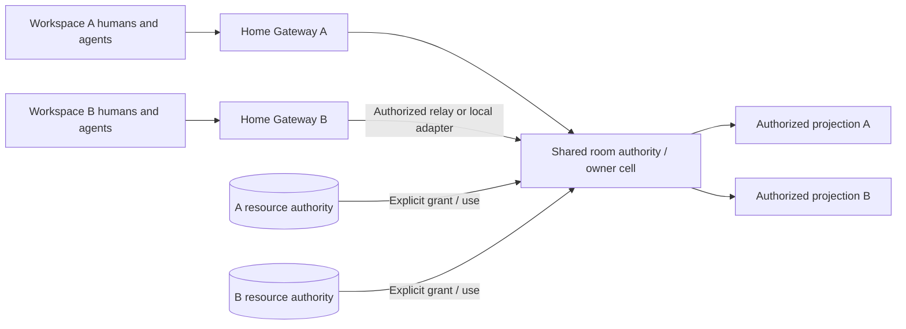

# Cross-workspace collaboration and federation

Version 0.5 | Architecture runway now, incremental delivery later. Workspace isolation remains the primary security and data ownership boundary. Sharing a room or agent does not join a foreign workspace or merge its ACLs, memory, credentials, billing or database. This design is for humans AND agents.

## Existing capability and gap

At reviewed Dewee commit 308e1ba, Team Room supports mutual cross-workspace grants (discover/message/task/publish) and authenticated cross-runtime relay for agents in shared external conversations. Each workspace retains its own room; peers receive limited profiles and permitted exchanges, never foreign room/member/event tables. This is a useful policy/relay precedent, not a native multi-human shared room or DM service. Existing resource grants and verified-requester policy are foundations for owner-side authorization, not blanket federation permission. Preserve existing semantics; extend through versioned adapters after contract review.

## Design decision: anchored shared room

Start with same hosted identity plane, even across separate workspaces in a cell. Each shared room has a single owning workspace and authoritative home cell; external workspace participants join only an explicit collaboration context after policy and mutual grants. Guests are not full members of the owning workspace. Next support different cells through authenticated server-to-server relay, not cross-cell DB joins. Later evaluate separately administered deployments (self-hosted/on-prem) with verified instance trust, key rotation, protocol compatibility and governance. Do not implement open public federation or decentralized consensus in alpha. No global people directory exposing tenant membership.

Owner writes canonical room messages/events and seq; participants keep authorized local projection/cursor only. A cross-cell sender gets pending until owner durably commits; stable origin event ID and idempotency key, owner sequence, signed receipt, outbox and retry. No offline acceptance by a replica, no dual-write or global ordering across rooms. Owner down: queue bounded or fail with pending/unknown, never show sent until durable ACK. Relay can be duplicated/out-of-order; validate current bilateral relation, room membership and policy epoch before accept, deliver and replay. Connection/subscription and cache scoped to exact room/share; no access to owning tenant-wide bus. Use existing relay primitives only after checking target capabilities; authenticated service identity, TLS, signed envelope/replay window/nonce, key rotation, destination binding and scoped data, never forward user bearer tokens. Cross-deployment trust discovery and key exchange require separate threat review.

## Identity and records (draft)

- Principal reference = verified issuer/instance + immutable subject + workspace + actor kind (human or agent), normalized server-side. Same human may have multiple workspace roles; do not merge via email or display name. No client-provided identity accepted as authority.
- Relationship: two verified workspace IDs, owning/admin approvals on each side, allowed collaboration types and directional capabilities, policy versions, expiry/revocation status.
- Shared context: immutable owner, home cell, canonical room ID, participants and partner IDs, explicit room-scoped memberships/invites, history visibility policy, contract version, retention/residency classification. DM is a restricted shared context with exact participants and approval/consent; no unsolicited cross-workspace DM or directory enumeration.
- Resource grant: owner workspace and exact resource/version, recipient workspace/principal/context, capability (discover/read/use/execute/share separately), constraints, expiry, audit and revocation. Reference or authorized result, not copying whole resource. Owner-side enforcement.
- Relay event: origin instance/workspace, origin event ID, room, actor assertion, policy epoch, causation ID, idempotency, timestamp, payload type/hash and authenticated envelope. Signed receipt binds canonical seq; data minimization by event visibility.
- Governance/audit ledger: relationship, policy/grant/consent revisions, delivery/denial/revocation, cost ownership and trace correlation; each workspace sees only its allowed projection.

These are new proposed entities/contracts. Reserve namespaced identity and resource references in alpha contracts now. Native local-only rooms remain default and require no federation infrastructure. Do not generalize existing per-tenant stores into unscoped queries.

## Shared room, DM and resources UX

Create partner relationship from verified invitation, choose scope (named shared room / specific principals / permitted resource), review policies and accept on both sides. External badge shows verified workspace/organization; room header lists who owns it, who can access, classification and retention summary. Add people/agents by authorized invite, not search all tenants. Shared room has separate nav group and safe context switch, "what will be shared" preview before sending artifacts. External DM is explicit opt-in (or permitted organization policy + receiver consent), restricted participant list, block/report/rate limit, no implicit organization connection from a message. Invited user can onboard from Emree without creating wrong workspace. Do not silently convert shared room to private or vice versa.

Shared resources:
| Type | Initial rule |
| --- | --- |
| File / knowledge | Explicit read grant or approved immutable export with provenance; underlying ACL checked on each fetch |
| Task / decision | Reference or bounded shared projection; owner retains authoritative state |
| Agent | Discover limited profile; invoke approved capability under owner policy; no owner credentials/system prompt/memory disclosure |
| Skills/workflows/MCP | Signed versioned package/export or scoped remote use; no transitive grant or raw secret |
| DevBox / device | Not shareable across workspace in first federation releases; artifact sharing only with explicit ACL |
| Credentials | Never transferable by room membership, never sent through relay |

External agent executes in its owning workspace, under its local permissions AND verified external request/delegation; no local owner impersonation. Inputs minimized to granted task/context. Result screened for data classification, recipient visibility and policy before release. Owner pays by default with explicit approved budget; later billing agreement only by both parties. Apply per-partner limits, chain causation, loop prevention and no unsolicited action. Sharing an agent does not grant its tools, resources or credentials to the requester. No hidden transitive sharing.

## Compliance and effective policy

Effective action = local requester identity and authority ∩ partner relationship ∩ room membership ∩ resource-owner grant ∩ both organizations' applicable policies ∩ agent delegation and execution policy. Deny on unknown/incompatible policy; restrictions compose, not union. Explicit policy evaluation on invitation, send, read/replay, attachment upload/download, share, agent run, delivery, export and revoke. Include configurable allowed domains/verified partners, data classification, DLP/secret scanning, permitted providers/models/regions, allowed actions, approval, budget, retention/legal hold/export, external participant removal and incident kill switch. Treat scanner as one control, not sole authorization. No actual compliance certification implied.

Before inviting, establish what data crosses boundary, where it resides, who can export, whether recipient copies allowed, retention/deletion obligations and response to legal hold. Incompatible retention/residency policies block collaboration; do not silently choose shorter/longer retention. Owner canonical retention and each authorized recipient archive governed by agreed policy; disclose that delivered/copied data cannot be remotely recalled, legal hold may prevent deletion. Default no history before join, no raw archive export unless agreed. Revoke relation stops new traffic, clears live subscriptions/leases and cancels/fences pending actions; in-flight uncertain effects reconciled. Previously permitted cached data purged where controllable; do not claim erasure of downloaded copies. Revoking room does not automatically revoke unrelated independently granted file rights; enumerate dependent grants and revoke as scoped policy dictates. Audit both sides, minimize logs and expose only authorized evidence.

## Delivery phases

- Alpha runway: versioned principal/resource references, room owner/home cell, ACL predicates, visibility and policy version; no cross-workspace UI advertised.
- F1 same-cell pilot: mutual partner approval, external members and shared room/DM, exact participant list, owner ordering, revocation, history boundary, user block; use synthetic two-tenant tests.
- F2 shared resources and agents: owner-side scoped grant, remote agent task/result, quotas, provenance, DLP/approval and policy checks, private outcomes, no transitive authority.
- F3 cross-cell: authenticated relay, outbox/inbox, dedup/ordering, replay and partial failure, key rotation, fail-closed revocation/partition, recovery and audit. No shared DB or implicit migration.
- F4 separate deployments: trust registry, mutually authenticated instance enrollment, version negotiation, operator controls, residency/retention/export and incident response. Explicit approval and independent security review; not a dependency for first Emree GA.

Release tests: same person different workspace roles; unauthorized external DM/invite; forged issuer/subject; stale grant/epoch; user removed during replay; attachment link leak; conflicting policies, retention/hold; foreign agent tries local tools/secret; quota/loop; relay replay/out-of-order/duplicate/unknown commit, owner failure, revoked key, cross-cell partition; deny and recovery trace parity. Test with two independent tenants and, for F3, two independent cells. External collaboration off by default until verified. No claim of immediate revocation through an unreachable peer: deny new effects when current authority cannot be verified, use short bounded leases and document already committed effects.

## Research references

[Slack Connect external collaboration](https://slack.com/help/articles/115004151203-Slack-Connect-guide--work-with-external-organizations) and [disconnect behavior](https://slack.com/help/articles/360063030933-Slack-Connect--Disconnect-from-an-organization) inform room ownership, explicit invitations and archive semantics. [Teams shared channels](https://learn.microsoft.com/en-us/microsoftteams/shared-channels) inform bilateral access and distinct resource permissions. [Matrix room authorization](https://spec.matrix.org/v1.11/rooms/v10/) informs signed event identity and membership state; avoid its decentralized state-resolution complexity for this initial single-owner design. [Dewee Team Room architecture](https://github.com/nextlevelbuilder/dewee/blob/308e1ba/docs/team-room-architecture.md) is the reviewed agent collaboration baseline.
