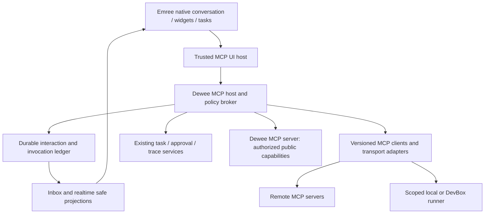

# Native MCP host and interoperability

Version 0.6 | 2026-11-27 | Proposed. A first-class MCP host is a product requirement, not an optional generic connector. Implement the latest verified stable protocol and stable official extensions natively across Emree/Dewee; support legacy protocol versions deliberately and stage beta/draft extensions separately. Capability advertisement means tested behavior, not a roadmap promise.

## Verified protocol baseline

The stable core verified for this design is 2026-07-28, with stateless per-request negotiation and MRTR. Recheck official release/extension matrix before implementation and every release. Compatibility must be per peer, per version and per extension, not based on provider names.

| Surface | Target / status |
| --- | --- |
| Core | JSON-RPC, server/discover, per-request metadata, Streamable HTTP and supported stdio; tools, resources/templates/read, prompts, pagination, progress, cancellation, errors, subscriptions and notification lifecycle |
| Structured results | Full JSON Schema 2020-12 tool schemas, typed result variants, arbitrary JSON structuredContent; bounded validation, no automatic external ref dereferencing |
| MRTR + elicitation | input_required, inputRequests, requestState and inputResponses, form/URL modes; resumable human input |
| MCP Apps | Stable 2026-01-26 UI protocol, negotiated io.modelcontextprotocol/ui; sandboxed HTML and JSON-RPC bridge |
| Tasks | Official 2026-07-28 io.modelcontextprotocol/tasks extension; server-directed resultType task, tasks/get, tasks/update, tasks/cancel; not legacy experimental Tasks |
| Authorization | Core OAuth resource/issuer/audience checks, CIMD preferred, DCR compatible while supported; official machine client credentials and enterprise-managed authorization extensions where applicable |
| Legacy | 2025-11-25 and other explicitly tested peers, initialize/session header, old in-call request behavior, legacy HTTP+SSE and deprecated roots/sampling/logging only under explicit compatibility policy |
| OpenAI extensions | Separately negotiated vendor namespace, compatibility adapter; see PLUGIN-COMPATIBILITY.md |
| Skills over MCP | io.modelcontextprotocol/skills, Beta at research snapshot; skills/list/get and verified resources/read, feature-gated |
| Events | io.modelcontextprotocol/events Beta; Dewee already has partial webhook-oriented client/server paths; validate current draft, implement only tested delivery modes |
| File transfer | Experimental draft as of Nov 10; prepare scoped storage interface, no stable support claim |

Read [core spec](https://modelcontextprotocol.io/specification/2026-07-28), [official release](https://blog.modelcontextprotocol.io/posts/2026-07-28/), [extension matrix](https://modelcontextprotocol.io/extensions/overview), [Apps](https://apps.extensions.modelcontextprotocol.io/api/), [Tasks](https://tasks.extensions.modelcontextprotocol.io/specification/2026-07-28/tasks), [Skills Beta](https://skills.extensions.modelcontextprotocol.io/specification/beta/skills), [Events](https://github.com/modelcontextprotocol/ext-events), [experimental files](https://blog.modelcontextprotocol.io/posts/exploring-file-uploads-and-downloads-in-mcp/). Stable extensions opt-in per connection/request; maintain explicit protocol/feature matrix and test fixtures. Do not make every extension mandatory for each peer. Deprecated mechanisms must have migration path and expiry review.

## Existing Dewee evidence (308e1ba)

Reviewed go.mod (mark3labs/mcp-go v1.6.0); internal/mcp has client pool/manager, credential resolution, OAuth, private endpoint policy, bridge and public/workspace servers, structured result handling and tracing. internal/mcp/events_client.go implements a separate stateless 2026-07-28 Events path using workspace credentials and guarded transport; events_server.go has events list/subscribe/unsubscribe and explicitly refuses unsupported poll/stream delivery modes. public_probe.go uses stateless modern protocol; bridge tests exist. This is evidence of partial modern support, not full core/extension conformance. Existing native workspace task tools are not MCP Tasks protocol. No complete Apps host, standard MRTR orchestration, Tasks extension or portable plugin loader was verified in reviewed paths. Inventory and run contract tests against current code before selecting SDK changes; avoid replacing secure auth/pool/trace layers needlessly.

## Architecture and responsibility

Dewee owns connection inventory, tool/resource/prompt discovery, user/workspace credential binding, permission, grants, network policy, invocation ledger, quotas, task supervision, trace and approval. Emree renders native forms, interactive apps and task controls. Existing Dewee CLI/MCP/CCP/RGD remain consistent and headless-compatible; no duplicate MCP manager in renderer. Emree device broker may host a user-approved local stdio MCP provider under separate installation/user scope and isolated process, with no inherited secrets, no generic shell bridge; DevBox runner optional. No local command executes on Gateway host because a package asked. Resource URI is a server-scoped identifier, not arbitrary fetch URL. Server side exports selected canonical operations, not blanket internal tool access. Different identity/permissions for operator, user, shared workspace and external collaboration.

Use Go MCP transport in Dewee, official SDKs or reviewed adapter where feasible; spike compare current SDK to official Go SDK before changing. Preserve stable API and secure legacy path. TS MCP Apps host/SDK reference and JSON Schema validators in renderer; Tauri system WebView test on all platforms. Pin exact SDK/spec versions; add golden fixtures and protocol conformance before rollout. For headless hosts, degrade to structured text or secure hosted human action link, never fake interaction or auto-approve. Client feature negotiation is based on actual supported renderer/transport and active policy.

## Core protocol upgrade and cache

Modern calls use routing headers Mcp-Method/Mcp-Name as applicable, per-request version/client/capabilities metadata, discover and result discriminators. Reject header/body mismatches and malformed capability. Legacy peers use their own negotiated lifecycle; never blindly send modern methods to legacy. Distinguish protocol session from product conversation/session identity, store durable operation handles server-side. No sticky requirement for modern MCP calls; existing Dewee WS runtime may still need stickiness. Cache list/read only within spec ttlMs/cacheScope and effective identity/server/credential/grant/policy scope, never shared positive authorization. Public cache only if verified server declares public and data contains no principal-specific info. Invalidate on revocation/changed notifications, use conservative default; schema size/depth/time limits. Forward trace context with allowed metadata only, prevent untrusted baggage leaking secrets. Maintain correlation run -> call -> continuation -> task -> delivery.

## Native forms and MRTR

When an authorized tool returns input_required, persist an invocation/interaction record bound to verified requester, workspace, server, original method/args hash, opaque requestState, request keys, policy epoch, expiry and trace. Render form using validated supported schema; never evaluate arbitrary code or accept unsupported field coercion. Reuse Human Interaction/Setup card infrastructure where semantics fit, but distinguish external elicitation from privileged platform approval. Accept/decline/cancel explicitly, revalidate exact response and current authority, then resume original operation with inputResponses and byte-exact requestState (new request ID) under round/size/time budgets. No model inventing a user's answer, no auto-submit on timeout, no busy LLM turn while waiting. URL mode uses safe user-confirmed external browser and validated server origin; never collect secrets in ordinary form/chat; no arbitrary URL handoff or secret in model context. Resume across device/restart, idempotent decision and stale/expired rejection. Legacy elicitation bridge separate; no unsupported MRTR claim. For group/shared rooms request private input to actual requester; group sees safe status only. Form display may offer native Emree fields and OpenAI extended schema via separate negotiated mapping.

## Native MCP Tasks

Model MCP task handle as external execution reference, not a second internal business task. Store server identity, subject/grant, handle, protocol and extension version, originating call ID, associated Dewee run/task, status/result/expiry/poll hint, policy version and correlation. Server chooses task response; client advertises support. Poll server with bounded backoff and provider hints, not per connected UI or tight loop. Task may contain in-progress requests; route to interaction ledger, use tasks/update according to spec; tasks/get obtains status/final result; cancel via tasks/cancel only if supported/current authority. Handle expiration, denied, unknown, terminal status and result without repeating side effect. Cancellation request is not proof of cancellation. Poll/worker persists and resumes without desktop or model session online. Task card shows provider, owner, progress, next input, cancel and final result; action inbox for user input, realtime projections on changes only. All task reads/control authorized; no enumerating foreign task handles, no fabricated tasks/list on modern extension. Existing native Dewee task tools link to this external task, not protocol equivalence. Server role may expose durable Dewee operation handles for eligible operations; map results/errors exactly, no generic job completion claims. Compatibility for legacy experimental task API only if separately proven; not a GA dependency.

## Native MCP Apps UI

Implement io.modelcontextprotocol/ui host. Tool metadata advertises _meta.ui.resourceUri; fetch matching ui:// resource through the same authorized MCP connection using resources/read, validate supported MIME/profile and metadata; never open arbitrary model URL. Use sandboxed opaque-origin iframe (allow-scripts only, no allow-same-origin or privileged parent native IPC), separate resource-serving origin/policy, restrictive CSP with declared allowed domains intersected with organization policy; validate source window, exact session, message IDs, schema, rate/size and lifecycle. For Tauri ensure untrusted frame never inherits privileged commands or custom scheme; real WebView escape tests required. Implement protocol initialize, host context/theme/locale, tool input/result notifications, tools/call, resources/read, ui/message, ui/update-model-context, permitted link/display operations and teardown according to pinned spec. Bind each request to specific server/tool visibility/instance, current user and resource authority; app-only tools not automatically model-visible. No wildcard proxy, auth token or direct local filesystem. Network capability declared and enforced; user-initiated external link confirmation; no unsafe clipboard/downloads. App may call only approved capabilities via host; fresh auth and human consent where policy requires. Treat UI annotations, text and app context as untrusted data. Host approval/credential/device cards remain trusted native UI, not app-rendered facsimiles.

Inline card, expandable right panel, fullscreen and picture-in-picture only where host capability implemented; settings, global sidebar, composer mention/file viewer via OpenAI adapter separately. Persist snapshot of historical result with timestamp, live instance separately, reauthorize when reopening. Do not publish private widget state/metadata into shared rooms; explicit share/export is a separate operation. If disabled/revoked/offline, show text fallback and reason, stop bridge/requests, dispose frame, invalidate cache. Durable writes and resource state remain server-owned, widget optimistic state never equals verified external success.

## Beta and future extensions

Events Beta: keep existing verified webhook support and explicit unsupported modes, add subscription consent, callback verification, signature, event dedup, cursor/gap recovery and scoped routine activation as spec evolves. OpenAI Events integration uses webhook subset, not full draft. Do not convert arbitrary events into unbounded agent runs. Skills Beta: discover manifest and digest/size, load SKILL.md/support resources on demand via scoped client, inspect executable scripts as untrusted, no implicit installation or execution, cache by digest/policy. File transfer draft: abstract authorized staged transfer and byte limits, no file contents in JSON chat, validate final spec before shipping. New extensions independently flag-gated; capability registry reflects actual support and revision.

## Release tests

Protocol fixtures for modern + legacy, discover, schemas, pagination, errors, cancellation, TTL/scope, subscription recovery, auth mismatch, SSRF. MRTR accept/decline/cancel, stale resume, duplicate submission, requester and group isolation; Tasks pending/terminal/input/retry/cancel/expiry, no duplicate effects. Apps run official examples and independent third-party test app with verified permission, inline/panel, tool visibility, CSP, message source spoofing, XSS/IPC/SSRF, revoke and cleanup. Auth extensions require separate machine/enterprise role tests; no elevation of service principal. Trace/CLI/MCP/CCP/RGD/Emree parity or documented N/A for presentation-only APIs. Conformance manifest lists implemented, tested, unsupported, experimental, deprecated, per version and platform. Release blocks on cross-tenant leak, unsafe bridge, secret in context/log, duplicate external effect or unsupported advertised capability. No live implementation/benchmark claimed by this spec.
