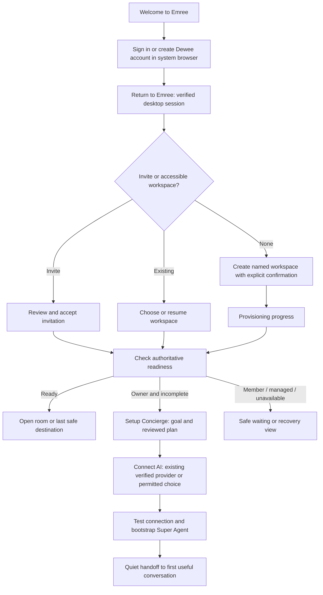

# Frictionless onboarding: Emree + Dewee

Version 0.5 | Proposed, not implemented. The customer downloads Emree to get work done, not to learn our system architecture. A new user must be able to sign up, create or join a Dewee workspace and complete the existing Dewee setup without manually visiting a dashboard, copying gateway credentials or understanding cells, providers or API concepts.

## Entry journeys

| User intent | Default journey |
| --- | --- |
| First time, no Dewee account | Welcome -> Continue -> trusted system-browser Dewee sign-up/sign-in -> return to Emree -> create workspace -> guided setup -> first useful task |
| Existing Dewee user with one workspace | Sign in -> discover authorized workspace -> ready: open last safe destination; incomplete: resume current setup |
| Existing user with multiple workspaces | Choose from named workspaces (recent first); add/join option; no raw IDs |
| Invited user | Open verified invite -> sign in/signup -> explicitly accept -> existing workspace; never create a redundant personal workspace |
| Self-hosted/dedicated | Secondary “Connect to your organization” flow -> explicit HTTPS server -> discover supported auth -> sign in locally or verified SSO if actually supported -> select workspace |
| Returning or interrupted | Resume server-owned setup/operation state; no repeated provisioning or secret entry after a completed step |

Default hosted entry button is “Get started” or “Continue with Dewee”; explain “One account for Emree and your team's AI agents” in plain language. Show enterprise connection as secondary. No separate Emree account or mandatory tutorial. Terms, cost/entitlement and organization creation require explicit consent; a default does not create or purchase resources silently.

## Existing baseline and required bridge

Source review: Dewee hosted OIDC provider and setup onboarding docs at commit 308e1ba. OIDC supports authorization code + PKCE S256, required state/nonce, discovery/JWKS, token rotation and revocation. Its SSO access token is userinfo-only; CCP APIs, extension BFF, Gateway and MCP intentionally reject it. First-party clients are operator-seeded; no Emree registration found in reviewed OIDC files. Current redirect checks require exact registered URI. Existing workspace creation is a browser-cookie, same-origin form route with ownership/entitlement checks, idempotent request and provisioning outbox. Invite acceptance likewise uses verified browser session. Do not reuse cookies or scrape web forms.

Required upstream work:
1. Register first-party Emree public native client in each approved environment (no embedded client secret). Review native redirect transport: preferably one-time loopback listener with fixed allowed IP/path and ephemeral port per RFC 8252; requires deliberate native-client matching change in authorize AND code exchange, not global relaxation of existing exact matching. Alternatively verified app-claimed HTTPS redirect after OS tests. Use external system browser, PKCE/state/nonce/issuer/audience/signature/expiry validation, exact callback context, one use; no embedded login webview.
2. Add a first-party desktop session issuance/exchange contract. Verify the dedicated SSO grant/family, client/audience and subject server-side; issue separately audience-bound desktop BFF credentials, rotating refresh and revocation linked to parent family. A userinfo-only token or ID token is not a generic Gateway bearer. No endpoint accepts arbitrary SSO tokens for workspace APIs. Scope workspace listing, create/join, setup, chat and actions independently. Recheck membership before minting existing runtime-scoped credentials; no master token.
3. Expose typed native endpoints for list/create/accept-invite and setup state, invoking the same canonical provisioning/ownership/plan services; preserve entitlements, explicit region override, idempotency, rate limits, audit and errors. Do not bypass CSRF-protected browser routes; create authenticated native handlers with separate audience validation. No duplicate identity/account store or provisioning logic. Use secure OS store for refresh tokens, access in native process; renderer only receives safe views.
4. Reuse existing Setup Concierge, plan, cards, provider validation, bootstrap and readiness contracts. Add native-compatible adapters and capability negotiation, not second state machine. Owner/admin actions remain restricted; invited member sees “Your team is getting ready” with actionable next step rather than privileged setup. Never bootstrap a platform-managed workspace.

## UX flow

New workspace default name suggested from explicitly supplied profile, editable. Ask one question at a time: “What would you like your AI team to help with?” Show goal templates plus free text. Concierge is deterministic before model connection; do not require AI calls to set up AI. Show plan in human terms, optional steps collapsible. Reuse existing verified provider if the authoritative plan permits. Offer Dewee Router only if eligible, available and price/credit/terms are clear; alternatively connect an existing supported subscription/provider. Never promise free inference or silently charge. Hosted secret form/OAuth runs in trusted first-party surface; return only secret-free completion/ref, never paste key into chat or send through plugins. Recovery: choose another model/provider, retry, replace key, revise plan where supported; do not simulate success.

Server owns setup plan revision, pending action and readiness; Emree owns presentation, transient draft and resume destination. Render validated versioned cards using core renderer. Unsupported card/contract: explain update/retry/manual safe first-party fallback, never interpret arbitrary HTML/commands. Existing quiet_handoff reserves first session without running model; first action initiated by user. Show optional integrations progressively; do not block first useful chat on channel/MCP installation. Device permission requests only when a feature needs them, never during welcome.

The main app is usable for permitted human collaboration when AI setup is unavailable, subject to upstream gate policy; current CCP chat gate still applies to agent chat. Jointly implement/test separate native human collaboration readiness if needed, not bypassing setup or workspace authorization. Distinguish provisioning, messaging ready, AI ready, and degraded states. If no entitlement for workspace creation, offer verified join/upgrade/support path; no synthetic workspace.

## Success and acceptance

Proposed targets, not measured: median first sign-in to ready human room <=90 seconds excluding user interaction/provider/actual provisioning waits; first usable agent conversation <=5 minutes for eligible default provider path under stated conditions. Measure wall-clock including waits separately; no mandatory technical configuration, no unnecessary browser dashboard visits; only trusted auth/secret handoffs leave Emree. Track funnel completion, time to first useful action, abandonment at each step, repair success, repeated requests and support tickets using privacy-preserving metadata. No raw goals or credentials in analytics.

E2E scenarios: new account, existing account/no workspace, one/many ready workspaces, invited new/existing user, provisioning retry, ownership limit, unsupported/disabled SSO, revoked/expired token, wrong issuer/audience, reused code, callback interception, canceled sign-in, app restart mid-setup, another device completes pending card, stale provider verification, OAuth cancel, no eligible provider, member/admin split, platform-managed, unsupported self-host edition, logout/switch isolation. Assert one workspace per idempotency key, no token leak, no premature agent activation, no duplicate handoff, same plan across CCP/Emree/CLI. Contract tests and real staging journey are release gates. Dewee hosted SSO provider is hosted-only at reviewed baseline; self-hosted client sign-in is separate work. Do not claim hosted SSO works in every on-prem install.

## References

[Dewee SSO documentation](https://github.com/nextlevelbuilder/dewee/blob/308e1ba/docs/dewee-sso-oidc-provider.md), [workspace setup](https://github.com/nextlevelbuilder/dewee/blob/308e1ba/docs/workspace-setup-onboarding.md), [RFC 8252](https://www.rfc-editor.org/rfc/rfc8252.html). Verify upstream versions before implementation.
