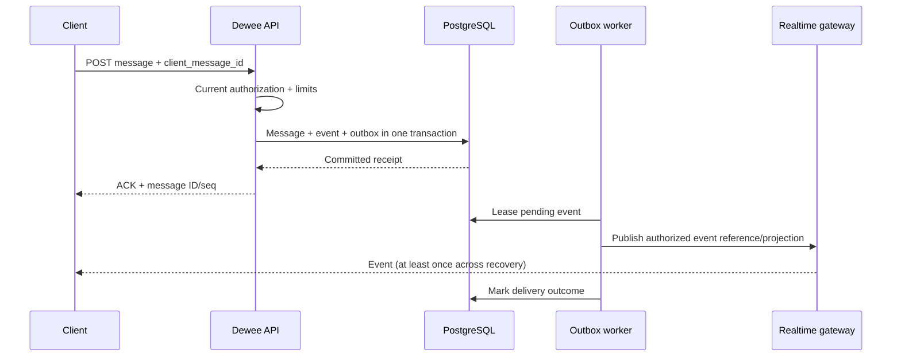

# Realtime messaging, data, cache and media

## Delivery planes

| Plane | Initial technology | Rule |
| --- | --- | --- |
| Durable user messages | HTTP + PostgreSQL transaction | ACK only after commit; independent of AI |
| Collaboration realtime | Centrifugo + Valkey candidate | Multiplex authorized subscriptions per cell; bounded history for recovery |
| Agent progress | Existing Dewee SSE mapped to semantic events | Coalesce deltas, persist final state; avoid DB write per token |
| Async work | PG transactional outbox / leased workers | At-least-once with idempotent effects |
| Terminal | Dedicated binary WS | Flow-controlled, no chat bus |
| Device commands | Separate scoped relay | No replay of uncertain side effects |
| File transfer | Private S3/R2 | Direct authorized upload, no base64 in room events |
| Calls/live monitoring (later) | WebRTC/SFU | No control authority implied by viewing |

## Send and reconnect

Client sends optimistic local item and never trusts local success as server ACK. Reconnect with exponential backoff/jitter and bounded retry. Refresh current credentials, revalidate memberships, resume from opaque cursor. To avoid a subscribe/history race, establish live subscription with a replay watermark and buffer events while fetching missing durable pages; dedup by event ID and resource version. If realtime history expired, obtain authorized delta or snapshot; prune revoked-room cache and invalidate old subscriptions. Presence/typing/deltas may be dropped on congestion, never durable changes. Use bounded outbound buffers, disconnect slow clients with resume hint; cap subscriptions, frame size, pending sends, request rate and room fan-out. Broadcast only to subscribed, authorized devices, not workspace-global sockets. ACL changes must take effect for existing sockets, history and search; validate at dispatch/replay with monotonic policy epoch and fail-closed resubscribe. A stale cache cannot authorize.

## Agent fan-out and queues

A normal message is not an automatic run. Explicit mention/policy routes to selected agents; coordinator owns chain depth, turns, token/time/budget caps and loop detection. Store causal chain ID and idempotent trigger key. Separate queues for durable delivery, agent dispatch, search/inbox, media; reserve priority lane for stop/revoke/approval, not dependent on model jobs. Job lease/fencing, bounded retries with jitter and dead-letter diagnostics; unknown external outcome requires reconciliation. Use fair per-tenant admission, concurrency and budgets. Keep long-running jobs outside HTTP request. Start with PG SKIP LOCKED and measured queue depth; introduce JetStream only when recovery, concurrency or contention demands. If Centrifugo Valkey already handles realtime, do not add parallel Core NATS just to duplicate fan-out.

## Database and cache

Postgres is authoritative for messages, ACL, metadata and durable event history. Use cursor pagination, indexed scoped queries, connection pool budgeting and PITR. Read replicas only for stale-tolerant reads; membership/critical state authoritative. Benchmark hot rooms before sharding: room sequencer row lock is deliberate, use bounded batches where correctness allows. Partition by workload and retention only with validated query plans; home cells provide primary horizontal partition.

| Cache | Contents / initial policy |
| --- | --- |
| Local SQLite | Recent authorized room history, read cursors, drafts, pending outbox; encrypted or no cache for sensitive orgs, size/age caps |
| UI memory | Projections and transient state; clear on account/cell switch |
| Valkey | Presence (~60 s TTL), typing (~3–5 s), short history (~5–15 min), safe versioned settings, rate limit counters |
| CDN | Public immutable/versioned assets only by default; private files require authorized fetch |
| Authorization | Never use stale positive cache to grant privileged effect; recheck current policy |

Cache is scoped by server, tenant, principal, resource and policy version. Revocation: disconnect subscription, purge local projection where possible, revoke grants, invalidate keys; cannot recall bytes already read on an untrusted device. Offline viewing governed by policy; no offline device commands or approvals; pending send requires reauthorization. No refresh token or secrets in SQLite. Encrypt using vetted storage/key mechanism after spike; if unavailable do not persist sensitive payloads.

## Media pipeline

Allocate attachment metadata + staging key after auth and quota reservation. Presigned upload with constrained object key, method, short TTL, size/checksum checks at completion; multipart for large files with explicit abort cleanup. Untrusted staging bucket/prefix cannot be publicly read. Verify actual MIME, bytes, checksum, size and owner; scan, quarantine, sandbox image/video/document transforms (libvips/FFmpeg), strip unsafe metadata as policy; mark ready only after clean. Publish attachment reference, not bytes. Download rechecks room AND file ACL, then short-lived URL or authenticated proxy for immediate revocation requirements. Presigned URLs are bearer capabilities until expiry; no public bucket or shared CDN caching of private content. Separate original, variants and artifact retention; no cross-tenant dedup leakage, garbage collect abandoned uploads, enforce deletion/legal hold. Never persist raw screenshots/terminal recordings by default.

R2 for hosted if residency permits; S3-compatible/private/local provider for self-host. Existing Dewee runtime filesystem is not transparently replaced by object storage; adapter for attachments only. Store metadata in PG and object integrity reference. Direct uploads/downloads bypass application bandwidth where policy permits.

## Sizing model (illustrative, not benchmark)

At 10,000 concurrent users, 2 human messages per 100 users per second, 2x agent amplification: 400 peak message writes/s. Mean 25 recipients -> 10,000 delivery frames/s; 500 active agent runs x 5 coalesced deltas/s x 10 observers -> 25,000 extra frames/s. At 1 KB per frame ~35 MB/s peak before overhead and media. Assuming 15% average peak, ~5.18M messages/day, ~233 GB/month at 1.5 KB/message raw excluding indexes/WAL/backups. Reality depends on fan-out, payloads, user behavior and run rates; measure per tenant/cell. Large room and reconnect storms separate test cases. Define throughput in committed writes, deliveries, concurrent sockets, queued job age and network egress, not just HTTP RPS.

## Benchmark gates

Alpha 1k CCU/cell; beta target 10k if measured; multi-cell 100k only after evidence. Use synthetic tenants, rooms, attachments and 30% reconnect in 60s; k6 + real protocol clients + fault injection. p95 ACK <=300ms, delivery <=500ms in same region at test workload, no committed-message loss under stated fault model, no duplicate logical effects, no unauthorized delivery. Record CPU/RAM/FDs/egress, DB pool and query p95, outbox lag, queue retries, stream drop counts, tenant fairness. Scale based on bottleneck, not arbitrary threshold. Validate revocation even during broker/cache outages.
