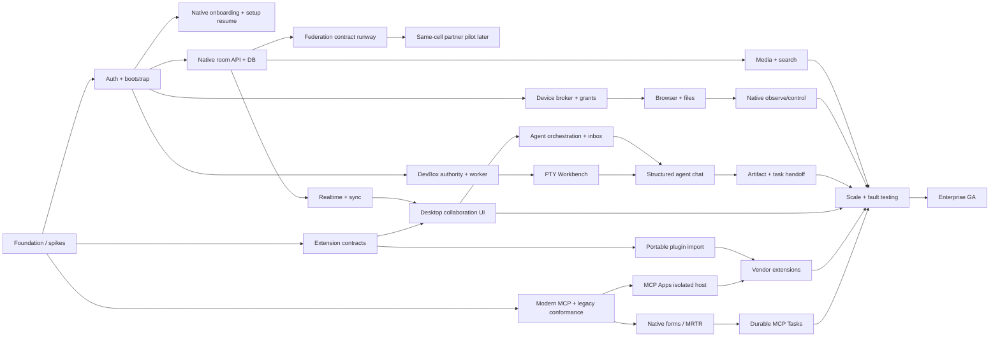

# Detailed implementation plan

Version 0.6 | 2026-11-27 | Proposed, not started. Read [decision brief](../DECISIONS.md), [PRD](../docs/PRD.md), [onboarding](../docs/ONBOARDING.md), [federation](../docs/FEDERATION.md) and [Dewee integration](../docs/DEWEE-INTEGRATION.md).

## 1. Agent-first delivery model

Plan in accepted implementation slices, not human labor units. A slice is an independently reviewable, bounded change or spike with a fresh context, explicit contract, expected tests, evidence and rollback. A Claude/Codex implementation session may finish one slice or require multiple attempts; session count is not a unit of time. A separate agent context reviews the diff, runs relevant tests and checks scope/authority. Only accepted slices count as progress. Rework, blocked jobs, failed reviews, quota, CI and human approval are recorded separately.

Assumed execution setup: four concurrent implementation lanes (Claude/Codex as appropriate) plus independent review capacity, separate worktrees, shared contract fixtures, no overlapping write ownership, verified Dewee test environment. Initial planning assumption: roughly one accepted slice per active lane per working day on average after calibration, not a measured result or guaranteed completion time. Some spikes, security review, OS tests and integration gates take longer; do not extrapolate individual model benchmarks to repository delivery.

| Phase | Accepted slices (provisional) | Calendar window from kickoff (conditional, overlapping) |
| --- | ---: | --- |
| P0 | 12–18 | Days 1–7 |
| P1 incl. onboarding, MCP core/forms/Apps, portable plugins and federation runway | 53–85 | Weeks 1–5; first useful vertical slice earlier if gates pass |
| P2a agent-native, MCP Tasks and vendor extensions | 21–34 | Weeks 4–8 |
| P2b DevBox Workbench | 20–32 | Weeks 4–8 |
| P3 Computer Use and scale | 17–30 | Weeks 6–11 |
| P4 GA evidence, auth extensions and conformance | 16–27 | Weeks 9–15 |
| Core through GA | 139–226 | Planning range 9–15 calendar weeks, not a release commitment |
| MCP beta/draft pilots | 3–5 | Separately gated, not GA blocker |
| F1–F4 federation (separate, post-runway) | 17–29 | Schedule after partner/security gates; same-cell pilot may overlap late beta |

Baseline scenario (4 implementation lanes + separate review): alpha 3–5 weeks, useful agent/DevBox and MCP Tasks beta 6–8 weeks, gated GA 9–15 weeks if dependencies and review throughput hold. These are conditional scenarios based on provisional accepted slices, not model benchmarks or measured forecast intervals. At 4 lanes, one accepted slice per active day and 5 active days/week, 139–226 slices divided by 20/week gives about 7–11.3 weeks before integration/dependency overhead; 25% adds roughly 9–14.2 weeks. Eight lanes do not guarantee half the time; reforecast after P0. Signing, physical devices, vendor and security approval, integration and quota waits may extend the range.

Calibrate after P0: record accepted slices per day and per lane, first-pass acceptance, median/p90 review cycle, retry count, blocked days, elapsed time from issue claim to verified merge, queue wait and evidence quality. Re-estimate remaining scope each wave using observed throughput and dependency critical path. Use Claude and Codex in distinct contexts; choose implementation/reviewer based on measured results, not fixed vendor assumptions. Human maintainers retain policy, security and release decisions. No fixed team size or launch date committed. [METR time-horizon caveat](https://evals.alignment.org/time-horizons/): success on benchmark tasks is not end-to-end elapsed delivery time for this project.

## 2. Dependency map

Ownership abbreviations: E = Emree client/SDK, D = Dewee upstream, O = infrastructure/operations, S = security/QA. Joint contracts reviewed by both E/D. No automatic upstream issue creation; reconcile existing issues first.

## 3. P0 — Foundation and technical spikes (12–18 slices)

| Package | Owner | Depends | Agent slices | Deliverable / proof |
| --- | --- | --- | --- | --- |
| F01 | E/S | none | 2–3 | Framework comparison, signed local assets, narrow IPC on macOS/Windows/Linux; cold start/idle memory, keyboard, accessibility, renderer compromise tests. Accept Tauri or document Electron fallback ADR. |
| F02 | D/E | none | 2–3 | Review current Dewee auth, Team Room, chat, DevBox, Browser Relay and plugin contracts; mock and real bootstrap fixture; capability/version matrix; native collaboration data/ACL ADR. |
| F03 | D/O/S | F02 | 2–3 | Centrifugo+Valkey spike: scoped subscribe, active revocation, recovery, 1k synthetic sockets and stale history tests. PG outbox race/crash prototype; decide transport. |
| F04 | D/O/S | F02 | 2–3 | gVisor PTY + runtime protocol spike, no host execution; test resize, signal, reconnect, non-root, guest network and credential boundaries. |
| F05 | E/S | F01 | 2–3 | Extension SDK lifecycle spike and threat model; one built-in + declarative panel, cleanup, denied action, install schema and compatibility. |

Checklist:
- [ ] Agree scope, public license/provenance, contributor policy, branch protection and review ownership.
- [ ] Establish contract fixture and source-of-truth convention, independent test tenant/guest and synthetic data.
- [ ] Record exact OS/library/runtime versions, PoC test commands, metrics and findings in ADRs.
- [ ] Decide which P0 hypotheses passed and which require changes; re-estimate before enabling privileged work.

Exit: framework, transport and DevBox feasibility evidence available; no unmitigated critical boundary failure. If Centrifugo fails revocation/replay test, use a bounded Go transport adapter. If native desktop framework fails, compare Electron. If gVisor PTY or runtime terms fail, retain safe management only, defer interactive execution.

MCP P0 package:

| Package | Owner | Depends | Agent slices | Deliverable / DoD |
| --- | --- | --- | --- | --- |
| M01 | E/D/S | F01,F02 | 2–3 | MCP version/SDK/extension conformance spike; test modern/legacy wire, examine official SDK vs existing Go stack, Apps sandbox and package schema; no unsupported advertisement. |

## 4. P1 — Collaboration alpha, onboarding, MCP and federation runway (53–85 slices)

| Package | Owner | Depends | Agent slices | Work breakdown and DoD |
| --- | --- | --- | --- | --- |
| A01 | E/D | F01,F02; O01 contract | 4–6 | Cargo/pnpm workspace and CI; app shell; native PKCE client and secure storage; typed bootstrap; multi-server/workspace switch; safe token refresh, sign-out and revoked session handling. O01 owns upstream first-party redirect/session issuance. |
| A02 | D | F02,A01 contract | 5–8 | Tenant-scoped native rooms/members/messages/events/DMs/threads/reactions/read state; migrations, cursor queries, idempotency, optimistic versions; REST and authorization; adapter stub to Team Room; negative tests. |
| A03 | D/O/E | A02,F03 | 4–6 | Transactional outbox and delivery worker; scoped connection/subscription tickets, realtime route; durable replay and snapshots; current ACL/revocation, backpressure, gap and reconnect tests. |
| A04 | E | A01,A02,A03 contracts | 4–6 | SQLite cache, typed sync reducer, draft/outbox, optimistic reconciliation, virtualized timeline, composer, threads, DMs, unread/presence, notifications; offline/purge and stale response tests. |
| A05 | D/E/O | A02 | 3–5 | Private attachment allocation, direct upload/complete, scan/quarantine, authorized download, thumbnails, cleanup; basic ACL-filtered FTS. |
| A06 | E/S | F05,A01 | 3–5 | SDK and built-in module contributions, signed/allowlisted declarative example, plugin manager states/permission diff, lifecycle and disable/rollback tests. |
| A07 | E/D/S | A01–A06 | 2–3 | Real two-human message journey, 1k CCU test, failure/replay, accessibility, update packaging dry-run, docs and release candidate evidence. |

Additional P1 work packages (can run alongside collaboration; O01 must precede native sign-up flows; X00 precedes final room schema):

| Package | Owner | Depends | Agent slices | Deliverable / DoD |
| --- | --- | --- | --- | --- |
| O01 | D/E/S | F02,F01 | 3–5 | First-party Emree OIDC native redirect + separate desktop session issuance, audience isolation, revoke, native API auth tests; no cookie scraping or generic SSO bearer. |
| O02 | D/E | O01 | 3–5 | Idempotent workspace create/join/list through existing services, explicit entitlement/region confirmation, invitation continuation, provisioning state and recovery. |
| O03 | E/D/S | O02 | 3–5 | Reuse Setup Concierge/cards, provider validation, readiness and quiet handoff; secret-free trusted handoff, retry and cross-client resume; invited/member/managed/self-host states. |
| X00 | D/E/S | F02; before A02 schema freeze | 2–3 | Federation runway: owner/home cell, issuer-qualified principal and resource refs, policy epoch, visibility and share context contracts. Local-only default; no external grants enabled. |

Additional mandatory MCP/portable plugin P1 packages:

| Package | Owner | Depends | Agent slices | Deliverable / DoD |
| --- | --- | --- | --- | --- |
| M02 | D/E | M01,A01 contract | 4–7 | Modern MCP client/server core, legacy negotiation, schemas/discovery/routing/cache/auth/notifications, preserve guarded transport and CLI/MCP parity; contract fixtures. |
| M03 | D/E/S | M02,A01 | 4–6 | MRTR form/URL, persistent invocation ledger, validated user response and current authority, trusted handoff, private group input, restart/expiry/cancel tests. |
| M05 | E/D/S | M02,A06 contract | 5–8 | Native standard MCP Apps isolated iframe, resources/tool metadata, standard bridge, inline/panel, host policy and fallback; real examples, IPC/CSP/revoke tests. |
| M06 | E/D/S | M01,A06 | 4–7 | Agent Plugins canonical importer/exporter and Claude/OpenAI legacy adapters; signed provenance, component/permission report, fresh auth, safe archive inspection and disabled hooks. |

Work slices in sequence:
- [ ] A01: install app -> system browser -> authenticated workspace -> disconnect/sign-out; no secrets in renderer.
- [ ] A02+A03: two clients -> send -> durable ACK -> realtime delivery -> disconnect/replay. Test DB crash before/after commit and duplicate client ID.
- [ ] A04: read history + private room revoke + workspace switch; local cache policy and safe offline retry.
- [ ] A05: upload clean and malicious fixtures; pending/failed states, size/checksum/quota, authorized access after scan.
- [ ] A06: example extension adds panel through SDK, cannot access ungranted action, unload leaves zero callbacks.
- [ ] A07: invite real design-partner test accounts on staging; publish acceptance evidence, not production release.

Exit: R01–R13 plus R33–R37, R42–R44 and R46 (onboarding and federation runway) alpha scope proven against real Dewee for supported edition, no cross-tenant exposure, message durability/recovery and quota gates. AI outage does not block human messaging. 1k CCU is a test target, not entitlement.

## 5. P2 — Agent-native collaboration, MCP and DevBox Workbench (41–66 slices)

### P2a: agent-native beta, Tasks and vendor extension compatibility (21–34 slices)

| Package | Owner | Depends | Agent slices | Work breakdown and DoD |
| --- | --- | --- | --- | --- |
| B01 | D/E | A02,A03 | 4–6 | Native Team Room adapter, verified human/agent participants, mention/routing, chain causality, token/turn limits, dedup and fairness; agent response projected to room; no external connector regressions. |
| B02 | D/E | B01 | 3–5 | Actionable inbox, existing interaction/approval cases, precise scopes/expiry, cancel/refuse/retry, current authority, private results and approval action card. |
| B03 | D/E | B01 | 3–5 | Link existing tasks/knowledge/assets, assign and handoff, shared task status, resource ACL, search, explicit share; no duplicated authority. |
| B04 | E/D/S | B01–B03 | 3–4 | Run explorer and semantic event projection, batching, stop/recovery, traces, acceptance and cost metrics; E2E task accepted by authorized reviewer. |

Additional P2a packages:

| Package | Owner | Depends | Agent slices | Deliverable / DoD |
| --- | --- | --- | --- | --- |
| M04 | D/E | M02,M03,B02 | 4–7 | Modern MCP Tasks durable handles, scoped poll/update/cancel, pending input, inbox projection, recovery, verified result and unknown effect tests. |
| M07 | E/D/S | M05,M06 | 4–7 | OpenAI vendor extension adapter: sidebar/panel/settings/onboarding, file viewer, mentions, display/deep links, form/context/message; capability-by-capability E2E, gated unsupported features. |

### P2b: DevBox Workbench (20–32 slices)

| Package | Owner | Depends | Agent slices | Work breakdown and DoD |
| --- | --- | --- | --- | --- |
| W01 | D/O/S | F04,A01 | 4–6 | DevBox access scopes, session authority, dedicated worker controller, placement/aggregate CPU-RAM admission, generation fencing, async lifecycle ops, typed capabilities. Guest/host separation and no mixed personal credentials; coordinate upstream #2696 and related issues. |
| W02 | D/O | W01 | 4–6 | Guest PTY/tmux if verified, binary stream relay, credits, resize, signals, bounded replay, exclusive control lease and terminate; negative cross-tenant/stale ticket tests. |
| W03 | E | A06,W02 contract | 3–5 | Official Workbench right sidebar, box/runtime/session picker, xterm.js, tabs, resize/maximize/pop-out, detach/reconnect, lifecycle/error states; task deep link with reauth. |
| W04 | D/E | W01,W03,B02 | 4–6 | Structured agent adapter contract (ACP/SDK/RPC), one reference runtime first, DSH packaging/ACP verification, safe tool bridge in guest, typed updates, approvals, cancel/resume capabilities. Expand runtime matrix only after tests. |
| W05 | D/E | W03,W04,B03 | 3–5 | Task/session/run links, authorized Git diff/file/artifact, explicit share and scoped preview; observer/takeover UI and private transcript policy. |
| W06 | S/O/E/D | W01–W05 | 2–4 | High-output and reconnect tests, guest isolation, stale generation, concurrent control, auth revocation, worker crash/recovery and trace parity; verify actual runtime availability. |

Checklist:
- [ ] Ship collaboration beta separately if DevBox gates not ready; do not block human chat.
- [ ] Demonstrate real human-to-agent-to-human task handoff with approval, budget and trace.
- [ ] Demonstrate opening DevBox right sidebar from task, TUI, resize, Ctrl-C, close and reattach with live process.
- [ ] Prove no command executes on Gateway host; no broad shared access before worker, quotas and access gate.
- [ ] Demonstrate structured prompt -> tool events -> approval -> cancel/final; mode switch unavailable when unsupported.
- [ ] Share one permitted diff/artifact back to room; observer cannot send input, old ticket fails after recreate.
- [ ] Reconcile DevBox compute costs, account terms and retention; feature flag remains off by default.

Exit: R14–R23, R45 and R47, real terminal and at least one real structured adapter verified in isolated DevBox. Do not claim all vendors support Chat or same-session conversion. A limited internal DevBox pilot is allowed only with explicit quotas/admission and single trust domain; broad shared beta waits for P3 hardening.

## 6. P3 — Computer Use and scale beta (17–30 slices)

| Package | Owner | Depends | Agent slices | Work breakdown and DoD |
| --- | --- | --- | --- | --- |
| C01 | E/D/S | A01,F01 | 3–5 | Separate Device Broker, secure install identity, enrollment/key rotation, scoped grant/ticket, native consent, independent emergency stop, no network inbound. |
| C02 | E/D | C01 | 3–5 | Existing browser relay integration, scoped local file read/write, safe path handling and UI, expiry/revoke, no target fallback, file audit. |
| C03 | E/S | C02 | 4–7 | macOS/Windows attended observe/control providers; screen/app selection, OS permission flow, exclusive input lease, lock/focus checks, stop and unknown outcome handling; real hardware tests. |
| C04 | E/S | C03 contract | 2–4 | Linux Wayland/PipeWire/portal capability and fallback assessment; explicit unsupported states; X11 separate threat review. |
| C05 | D/O | A07,W06 | 3–5 | 10k CCU target, hot room/agent flood, media backlog, DevBox disk quotas and idle reconciler, worker capacity/placement, HA, queue tuning; JetStream decision only if evidence. |
| C06 | S/E/D/O | C01–C05 | 2–4 | Fault injection across broker/queue/DB, revocation under partition, physical OS matrix, privacy and terminal/control load isolation. |

Checklist:
- [ ] Start with browser and chosen local files, not full desktop control.
- [ ] Run Computer Use on a synthetic test app, prove explicit permission and local stop offline.
- [ ] Measure p95 stop and revoke; prove no delayed action after grant expiry, no stuck key/button after disconnect.
- [ ] Record unsupported environments and block actions by capability, not marketing copy.
- [ ] Load-test 10k CCU per cell under declared workload if resources allow, 30% reconnect and hot-room skew; adjust target based on measured evidence.
- [ ] Add enforced disk quota and idle policy for DevBox; test active sessions prevent sleep.
- [ ] Independent security review before enabling desktop.control.

Exit: R24–R27 gated; Computer Use can be released independently per platform, without claiming unsupported OS parity. Broad DevBox access requires actual quota/isolation/recovery evidence.

## 7. P4 — Enterprise GA and MCP conformance (16–27 slices)

| Package | Owner | Depends | Agent slices | Work breakdown and DoD |
| --- | --- | --- | --- | --- |
| G01 | E/O/S | A07 | 3–5 | Cross-platform release build, signing/notarization, updater trust, rollback, SBOM, accessibility and bilingual UI; clean install/upgrade tests. |
| G02 | D/O/S | C05 | 3–5 | Hosted and self-hosted reference topology, observability, health, rollout/drain, backup/restore drill, data residency, migration and operator docs. |
| G03 | E/D/S | A06 | 2–4 | Signed registry/private catalog, bundle profiles, pin/update/revoke and no permission widening; integrate existing Dewee registry if available. |
| G04 | E/D/S | B04,W06,C06,G01–G03 | 3–5 | E2E release matrix, penetration/security review, SLO evidence, issue triage, support docs, design-partner acceptance, rollback rehearsal. |
| G05 | Product/E/O | G04 | 2–3 | Launch scope, license/contribution policy, support lifecycle, pricing/compute cost, measurement plan, go/no-go record. |

Exit: R28–R31 and R48, signed installers and verified updater, real self-hosted and hosted tests, security and restore evidence. GA decision by owner; no automatic enablement or deployment. Public marketplace, arbitrary executable extensions, voice/video, external execution providers, cross-cell migration, advanced federation and mobile follow prioritized demand, not prerequisite unless enterprise contract requires.

Additional P4 package:

| Package | Owner | Depends | Agent slices | Deliverable / DoD |
| --- | --- | --- | --- | --- |
| M08 | D/E/S | M02–M07 | 3–5 | Applicable stable authorization extensions, conformance matrix and independent interoperability/security release review; actual supported revisions/features documented. |

Separate experimental pilot (not included in core GA):

| Package | Owner | Depends | Agent slices | Deliverable / DoD |
| --- | --- | --- | --- | --- |
| M09 | D/E | M02,M06 | 3–5 | Pin Skills/Events Beta and draft file-transfer revision, validate scoped discovery/verified file reads/webhook subscriptions/authorized staged transfer, explicit opt-in and unsupported status; no stable claim. |

## 8. Federation milestones (separate gated delivery; 17–29 slices)

The contract runway X00 is required in alpha; do not require live federation for first GA. Implement following work only after product/security approval and upstream reconciliation.

| Package | Owner | Depends | Agent slices | Deliverable / DoD |
| --- | --- | --- | --- | --- |
| X01 | D/E/S | X00,A07,O03 | 4–7 | Same-cell verified partner relationship, bilateral consent, owner-anchored room and external DM, scoped membership, block/invite/history/revoke, two-tenant E2E. |
| X02 | D/E/S | X01,B04 | 4–7 | Explicit resource/agent grants, owner-side execution, policy intersection, provenance, budgets, DLP/retention and authorized task/result sharing; no secret or transitive sharing. |
| X03 | D/O/S | X01,X02 | 5–8 | Cross-cell relay and authoritative ACK, signed scoped envelopes, retry/dedup, order, key rotation, disconnect/revoke/partition, fault tests across two independent cells. |
| X04 | D/O/E/S | X03 | 4–7 | Independent deployment trust registry, version/identity enrollment, partner policies, retention/legal-hold/export/residency conflict handling, operator audit and incident kill switch; external security review. |

Pilot acceptance: R38–R41 as applicable. Local-only workspace unaffected if federation is unavailable. Same-cell pilot may overlap late beta; do not commit a date before two-tenant acceptance and policy decisions. More complex cross-deployment phase is not part of core GA estimate.

## 9. Test strategy and release gates

| Suite | Evidence |
| --- | --- |
| Unit | Reducers, SDK registry/disposal, idempotency, auth/permission parser, state machine |
| Contract | JSON schema, Rust/TS/Go golden fixtures, version negotiation, typed error parity |
| Integration | Real Dewee tenant with two humans and one agent, authorized rooms and sessions, object store, PG outbox |
| Security | Cross-tenant, revoked membership, stale tickets, malicious files/plugins/guest/terminal output, unsafe native bridge, no credential leakage |
| Fault | DB commit/ACK loss, broker outage, queue redelivery, cache eviction, worker restart, device disconnect/unknown, replay gap |
| Load | 1k alpha, 10k beta target, peak writes/fanout/deltas, 30% reconnect, high-output terminal and media, per-tenant fairness |
| OS | Physical supported Windows/macOS and Linux compositor matrix, installer/update, input stop, permissions, accessibility |
| Recovery | Backup restore, regional RPO/RTO, update and schema rollback, revoked extension/device cleanup |

DoD for every work package: linked requirement/decision; current source verified; design/security review; scoped change and migration compatibility; success and non-happy-path tests; reproducible evidence (commands, versions, artifacts, metrics); docs/feature flag/API and CLI/MCP/CCP/RGD/trace parity or N/A; no unresolved high-severity blocker. Treat unexecuted checks as not run. Requirements trace table in PR or report. Critical/high risks block release. Stop when architecture violates isolation, product fails design-partner outcome test, vendor terms forbid execution, or measured unit economics unacceptable; revise scope/decision instead of adding more infrastructure.

## 10. Suggested issue decomposition

Create issues only after owner review and dedup upstream. No automatic labels or assignees. Recommended initial tracker:
- Epic E0: greenfield foundation (F01–F05).
- Epic E1: native collaboration + auth (A01–A04); native onboarding (O01–O03); federation runway (X00).
- Epic E2: attachments and search (A05).
- Epic E3: extension platform (A06, G03).
- Epic E4: agent-native orchestration/inbox/tasks (B01–B04).
- Epic E5: DevBox worker/session foundation (W01–W02; upstream).
- Epic E6: Emree Workbench TUI/Chat (W03–W06; joint).
- Epic E7: device broker/Computer Use (C01–C04).
- Epic E8: scaling, quotas and reliability (C05–C06, G02).
- Epic E9: secure distribution and enterprise launch (G01,G04,G05).
- Epic E10: federation pilots (X01–X04, separately gated).
- Epic E11: modern MCP, forms, Apps, Tasks, conformance and portable plugins (M01–M08), beta/draft pilot (M09).

Each child issue contains dependencies, user journey, allowed authority, explicit non-goals, file/repo ownership, contract, tests, evidence and rollback. Link upstream DevBox issues rather than duplicating. Use acceptance criteria from tables, not vague completion by code existence.

## 11. First execution wave / fresh-context handoff

Start with F01, F02, F05 in parallel on fresh branches; an independent review lane validates each accepted slice; use synthetic fixtures. D/E agree bootstrap and room/event DTOs; E builds minimal shell and declarative registry, D builds real auth/room proof after contract review; F03/F04 risk spikes run independently with no production secrets. Keep a daily engineering log with measured evidence and decision changes. First demo: new user -> Dewee SSO -> create/join -> resume setup -> first useful conversation/native test room -> send/receive -> extension panel install/disable -> reconnect/revoke. Next demo: DevBox TUI in right sidebar. No code is started by this plan.
