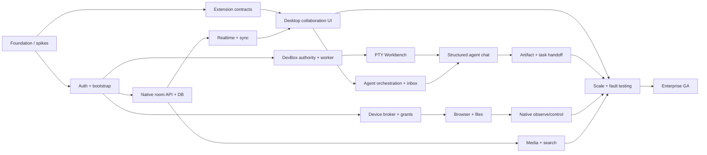

# Detailed implementation plan

Version 0.4 | 2026-11-27 | Not started. All checkboxes represent planned work, not completed work. See [decision brief](../DECISIONS.md), [PRD](../docs/PRD.md) and [Dewee integration](../docs/DEWEE-INTEGRATION.md). The plan supersedes earlier conceptual estimates by explicitly including DevBox Workbench and upstream work.

## 1. Delivery strategy and staffing

Use vertical slices, not separate teams building hypothetical SDKs for months. First prove two users and one agent can complete one task in a real Dewee workspace; mock services support parallel UI development but do not count as end-to-end proof. Then prove safe remote terminal, structured coding chat and attended Computer Use. Keep experimental privileged features dark until independent review. Avoid all-at-once launch.

| Phase | Outcome | Estimate (engineer-weeks, including upstream work) |
| --- | --- | --- |
| P0 | Greenfield foundation and risk spikes | 7–11 |
| P1 | Native collaboration alpha | 32–49 |
| P2 | Agent-native beta plus DevBox Workbench | 45–71 |
| P3 | Computer Use and scale beta | 27–44 |
| P4 | Enterprise GA and distribution | 17–28 |
| Total | Conditional scope through GA | 128–203 |

Earlier plugin-first estimate was 103–163 EW before the DevBox workbench scope; this plan adds 25–40 EW for DevBox sessions, worker boundary, terminal, adapters, artifacts and verification. This is a rough order-of-magnitude allocation, not a sprint commitment. Assuming 5–7 effective engineers, workstreams may overlap, but critical dependencies and review gates drive duration. Reserve contingency for external protocols, signing, vendor terms and platform behavior; re-estimate after P0 and each exit gate. Do not assume calendar estimates by simply dividing effort by headcount.

Suggested team: one product/tech lead, 1–2 Go/Dewee engineers, 1–2 desktop/React engineers, one Rust/native engineer, shared SRE/security/QA capacity. Native OS specialists may be required. Public contribution work should be small, independent, fixture-testable and not require production access. No staffing or launch date confirmed.

## 2. Dependency map

Ownership abbreviations: E = Emree client/SDK, D = Dewee upstream, O = infrastructure/operations, S = security/QA. Joint contracts reviewed by both E/D. No automatic upstream issue creation; reconcile existing issues first.

## 3. P0 — Foundation and technical spikes (7–11 EW)

| Package | Owner | Depends | EW | Deliverable / proof |
| --- | --- | --- | --- | --- |
| F01 | E/S | none | 2–3 | Framework comparison, signed local assets, narrow IPC on macOS/Windows/Linux; cold start/idle memory, keyboard, accessibility, renderer compromise tests. Accept Tauri or document Electron fallback ADR. |
| F02 | D/E | none | 2–3 | Review current Dewee auth, Team Room, chat, DevBox, Browser Relay and plugin contracts; mock and real bootstrap fixture; capability/version matrix; native collaboration data/ACL ADR. |
| F03 | D/O/S | F02 | 1–2 | Centrifugo+Valkey spike: scoped subscribe, active revocation, recovery, 1k synthetic sockets and stale history tests. PG outbox race/crash prototype; decide transport. |
| F04 | D/O/S | F02 | 1–2 | gVisor PTY + runtime protocol spike, no host execution; test resize, signal, reconnect, non-root, guest network and credential boundaries. |
| F05 | E/S | F01 | 1 | Extension SDK lifecycle spike and threat model; one built-in + declarative panel, cleanup, denied action, install schema and compatibility. |

Checklist:
- [ ] Agree scope, public license/provenance, contributor policy, branch protection and review ownership.
- [ ] Establish contract fixture and source-of-truth convention, independent test tenant/guest and synthetic data.
- [ ] Record exact OS/library/runtime versions, PoC test commands, metrics and findings in ADRs.
- [ ] Decide which P0 hypotheses passed and which require changes; re-estimate before enabling privileged work.

Exit: framework, transport and DevBox feasibility evidence available; no unmitigated critical boundary failure. If Centrifugo fails revocation/replay test, use a bounded Go transport adapter. If native desktop framework fails, compare Electron. If gVisor PTY or runtime terms fail, retain safe management only, defer interactive execution.

## 4. P1 — Collaboration alpha (32–49 EW)

| Package | Owner | Depends | EW | Work breakdown and DoD |
| --- | --- | --- | --- | --- |
| A01 | E/D | F01,F02 | 6–9 | Cargo/pnpm workspace and CI; app shell; external-browser PKCE; OS keyring; typed bootstrap; multi-server/workspace switch; safe token refresh, sign-out and revoked session handling. |
| A02 | D | F02,A01 contract | 8–12 | Tenant-scoped native rooms/members/messages/events/DMs/threads/reactions/read state; migrations, cursor queries, idempotency, optimistic versions; REST and authorization; adapter stub to Team Room; negative tests. |
| A03 | D/O/E | A02,F03 | 6–9 | Transactional outbox and delivery worker; scoped connection/subscription tickets, realtime route; durable replay and snapshots; current ACL/revocation, backpressure, gap and reconnect tests. |
| A04 | E | A01,A02,A03 contracts | 4–6 | SQLite cache, typed sync reducer, draft/outbox, optimistic reconciliation, virtualized timeline, composer, threads, DMs, unread/presence, notifications; offline/purge and stale response tests. |
| A05 | D/E/O | A02 | 3–5 | Private attachment allocation, direct upload/complete, scan/quarantine, authorized download, thumbnails, cleanup; basic ACL-filtered FTS. |
| A06 | E/S | F05,A01 | 3–5 | SDK and built-in module contributions, signed/allowlisted declarative example, plugin manager states/permission diff, lifecycle and disable/rollback tests. |
| A07 | E/D/S | A01–A06 | 2–3 | Real two-human message journey, 1k CCU test, failure/replay, accessibility, update packaging dry-run, docs and release candidate evidence. |

Work slices in sequence:
- [ ] A01: install app -> system browser -> authenticated workspace -> disconnect/sign-out; no secrets in renderer.
- [ ] A02+A03: two clients -> send -> durable ACK -> realtime delivery -> disconnect/replay. Test DB crash before/after commit and duplicate client ID.
- [ ] A04: read history + private room revoke + workspace switch; local cache policy and safe offline retry.
- [ ] A05: upload clean and malicious fixtures; pending/failed states, size/checksum/quota, authorized access after scan.
- [ ] A06: example extension adds panel through SDK, cannot access ungranted action, unload leaves zero callbacks.
- [ ] A07: invite real design-partner test accounts on staging; publish acceptance evidence, not production release.

Exit: R01–R13 alpha scope proven against real Dewee for supported edition, no cross-tenant exposure, message durability/recovery and quota gates. AI outage does not block human messaging. 1k CCU is a test target, not entitlement.

## 5. P2 — Agent-native collaboration and DevBox Workbench (45–71 EW)

### P2a: agent-native beta (20–31 EW)

| Package | Owner | Depends | EW | Work breakdown and DoD |
| --- | --- | --- | --- | --- |
| B01 | D/E | A02,A03 | 6–9 | Native Team Room adapter, verified human/agent participants, mention/routing, chain causality, token/turn limits, dedup and fairness; agent response projected to room; no external connector regressions. |
| B02 | D/E | B01 | 5–8 | Actionable inbox, existing interaction/approval cases, precise scopes/expiry, cancel/refuse/retry, current authority, private results and approval action card. |
| B03 | D/E | B01 | 5–8 | Link existing tasks/knowledge/assets, assign and handoff, shared task status, resource ACL, search, explicit share; no duplicated authority. |
| B04 | E/D/S | B01–B03 | 4–6 | Run explorer and semantic event projection, batching, stop/recovery, traces, acceptance and cost metrics; E2E task accepted by authorized reviewer. |

### P2b: DevBox Workbench (25–40 EW)

| Package | Owner | Depends | EW | Work breakdown and DoD |
| --- | --- | --- | --- | --- |
| W01 | D/O/S | F04,A01 | 5–8 | DevBox access scopes, session authority, dedicated worker controller, placement/aggregate CPU-RAM admission, generation fencing, async lifecycle ops, typed capabilities. Guest/host separation and no mixed personal credentials; coordinate upstream #2696 and related issues. |
| W02 | D/O | W01 | 6–9 | Guest PTY/tmux if verified, binary stream relay, credits, resize, signals, bounded replay, exclusive control lease and terminate; negative cross-tenant/stale ticket tests. |
| W03 | E | A06,W02 contract | 4–6 | Official Workbench right sidebar, box/runtime/session picker, xterm.js, tabs, resize/maximize/pop-out, detach/reconnect, lifecycle/error states; task deep link with reauth. |
| W04 | D/E | W01,W03,B02 | 5–8 | Structured agent adapter contract (ACP/SDK/RPC), one reference runtime first, DSH packaging/ACP verification, safe tool bridge in guest, typed updates, approvals, cancel/resume capabilities. Expand runtime matrix only after tests. |
| W05 | D/E | W03,W04,B03 | 3–5 | Task/session/run links, authorized Git diff/file/artifact, explicit share and scoped preview; observer/takeover UI and private transcript policy. |
| W06 | S/O/E/D | W01–W05 | 2–4 | High-output and reconnect tests, guest isolation, stale generation, concurrent control, auth revocation, worker crash/recovery and trace parity; verify actual runtime availability. |

Checklist:
- [ ] Ship collaboration beta separately if DevBox gates not ready; do not block human chat.
- [ ] Demonstrate real human-to-agent-to-human task handoff with approval, budget and trace.
- [ ] Demonstrate opening DevBox right sidebar from task, TUI, resize, Ctrl-C, close and reattach with live process.
- [ ] Prove no command executes on Gateway host; no broad shared access before worker, quotas and access gate.
- [ ] Demonstrate structured prompt -> tool events -> approval -> cancel/final; mode switch unavailable when unsupported.
- [ ] Share one permitted diff/artifact back to room; observer cannot send input, old ticket fails after recreate.
- [ ] Reconcile DevBox compute costs, account terms and retention; feature flag remains off by default.

Exit: R14–R23, real terminal and at least one real structured adapter verified in isolated DevBox. Do not claim all vendors support Chat or same-session conversion. A limited internal DevBox pilot is allowed only with explicit quotas/admission and single trust domain; broad shared beta waits for P3 hardening.

## 6. P3 — Computer Use and scale beta (27–44 EW)

| Package | Owner | Depends | EW | Work breakdown and DoD |
| --- | --- | --- | --- | --- |
| C01 | E/D/S | A01,F01 | 4–7 | Separate Device Broker, secure install identity, enrollment/key rotation, scoped grant/ticket, native consent, independent emergency stop, no network inbound. |
| C02 | E/D | C01 | 5–8 | Existing browser relay integration, scoped local file read/write, safe path handling and UI, expiry/revoke, no target fallback, file audit. |
| C03 | E/S | C02 | 8–13 | macOS/Windows attended observe/control providers; screen/app selection, OS permission flow, exclusive input lease, lock/focus checks, stop and unknown outcome handling; real hardware tests. |
| C04 | E/S | C03 contract | 3–6 | Linux Wayland/PipeWire/portal capability and fallback assessment; explicit unsupported states; X11 separate threat review. |
| C05 | D/O | A07,W06 | 4–6 | 10k CCU target, hot room/agent flood, media backlog, DevBox disk quotas and idle reconciler, worker capacity/placement, HA, queue tuning; JetStream decision only if evidence. |
| C06 | S/E/D/O | C01–C05 | 3–4 | Fault injection across broker/queue/DB, revocation under partition, physical OS matrix, privacy and terminal/control load isolation. |

Checklist:
- [ ] Start with browser and chosen local files, not full desktop control.
- [ ] Run Computer Use on a synthetic test app, prove explicit permission and local stop offline.
- [ ] Measure p95 stop and revoke; prove no delayed action after grant expiry, no stuck key/button after disconnect.
- [ ] Record unsupported environments and block actions by capability, not marketing copy.
- [ ] Load-test 10k CCU per cell under declared workload if resources allow, 30% reconnect and hot-room skew; adjust target based on measured evidence.
- [ ] Add enforced disk quota and idle policy for DevBox; test active sessions prevent sleep.
- [ ] Independent security review before enabling desktop.control.

Exit: R24–R27 gated; Computer Use can be released independently per platform, without claiming unsupported OS parity. Broad DevBox access requires actual quota/isolation/recovery evidence.

## 7. P4 — Enterprise GA (17–28 EW)

| Package | Owner | Depends | EW | Work breakdown and DoD |
| --- | --- | --- | --- | --- |
| G01 | E/O/S | A07 | 4–7 | Cross-platform release build, signing/notarization, updater trust, rollback, SBOM, accessibility and bilingual UI; clean install/upgrade tests. |
| G02 | D/O/S | C05 | 4–6 | Hosted and self-hosted reference topology, observability, health, rollout/drain, backup/restore drill, data residency, migration and operator docs. |
| G03 | E/D/S | A06 | 3–5 | Signed registry/private catalog, bundle profiles, pin/update/revoke and no permission widening; integrate existing Dewee registry if available. |
| G04 | E/D/S | B04,W06,C06,G01–G03 | 4–7 | E2E release matrix, penetration/security review, SLO evidence, issue triage, support docs, design-partner acceptance, rollback rehearsal. |
| G05 | Product/E/O | G04 | 2–3 | Launch scope, license/contribution policy, support lifecycle, pricing/compute cost, measurement plan, go/no-go record. |

Exit: R28–R31, signed installers and verified updater, real self-hosted and hosted tests, security and restore evidence. GA decision by owner; no automatic enablement or deployment. Public marketplace, arbitrary executable extensions, voice/video, external execution providers, cross-cell migration and mobile follow prioritized demand, not prerequisite unless enterprise contract requires.

## 8. Test strategy and release gates

| Suite | Evidence |
| --- | --- |
| Unit | Reducers, SDK registry/disposal, idempotency, auth/permission parser, state machine |
| Contract | JSON schema, Rust/TS/Go golden fixtures, version negotiation, typed error parity |
| Integration | Real Dewee tenant with two humans and one agent, authorized rooms and sessions, object store, PG outbox |
| Security | Cross-tenant, revoked membership, stale tickets, malicious files/plugins/guest/terminal output, unsafe native bridge, no credential leakage |
| Fault | DB commit/ACK loss, broker outage, queue redelivery, cache eviction, worker restart, device disconnect/unknown, replay gap |
| Load | 1k alpha, 10k beta target, peak writes/fanout/deltas, 30% reconnect, high-output terminal and media, per-tenant fairness |
| OS | Physical supported Windows/macOS and Linux compositor matrix, installer/update, input stop, permissions, accessibility |
| Recovery | Backup restore, regional RPO/RTO, update and schema rollback, revoked extension/device cleanup |

DoD for every work package: linked requirement/decision; current source verified; design/security review; scoped change and migration compatibility; success and non-happy-path tests; reproducible evidence (commands, versions, artifacts, metrics); docs/feature flag/API and CLI/MCP/CCP/RGD/trace parity or N/A; no unresolved high-severity blocker. Treat unexecuted checks as not run. Requirements trace table in PR or report. Critical/high risks block release. Stop when architecture violates isolation, product fails design-partner outcome test, vendor terms forbid execution, or measured unit economics unacceptable; revise scope/decision instead of adding more infrastructure.

## 9. Suggested issue decomposition

Create issues only after owner review and dedup upstream. No automatic labels or assignees. Recommended initial tracker:
- Epic E0: greenfield foundation (F01–F05).
- Epic E1: native collaboration + auth (A01–A04).
- Epic E2: attachments and search (A05).
- Epic E3: extension platform (A06, G03).
- Epic E4: agent-native orchestration/inbox/tasks (B01–B04).
- Epic E5: DevBox worker/session foundation (W01–W02; upstream).
- Epic E6: Emree Workbench TUI/Chat (W03–W06; joint).
- Epic E7: device broker/Computer Use (C01–C04).
- Epic E8: scaling, quotas and reliability (C05–C06, G02).
- Epic E9: secure distribution and enterprise launch (G01,G04,G05).

Each child issue contains dependencies, user journey, allowed authority, explicit non-goals, file/repo ownership, contract, tests, evidence and rollback. Link upstream DevBox issues rather than duplicating. Use acceptance criteria from tables, not vague completion by code existence.

## 10. First sprint / fresh-context handoff

Start with F01, F02, F05 in parallel on fresh branches; use synthetic fixtures. D/E agree bootstrap and room/event DTOs; E builds minimal shell and declarative registry, D builds real auth/room proof after contract review; F03/F04 risk spikes run independently with no production secrets. Keep a daily engineering log with measured evidence and decision changes. First demo: app sign-in -> native test room -> send and receive -> extension panel install/disable -> reconnect/revoke. Next demo: DevBox TUI in right sidebar. No code is started by this plan.
