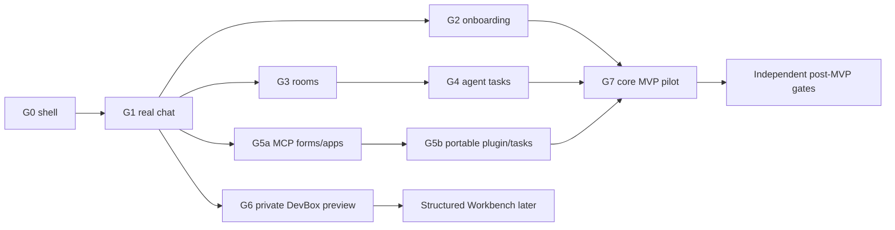

# MVP roadmap: verify value one vertical slice at a time

Version 0.7 | 2026-11-27 | Planning only. Parent [Emree #1](https://github.com/nextlevelbuilder/emree/issues/1), upstream [Dewee #3227](https://github.com/nextlevelbuilder/dewee/issues/3227). This roadmap supersedes initial release ordering in [IMPLEMENTATION.md](IMPLEMENTATION.md), not its target scope, requirements or ADRs. See [gap audit](../docs/MVP-GAP-AUDIT.md) and [evidence ledger](EVIDENCE.md).

## MVP definition and milestones

A new user can sign in through Dewee SSO, create or join and finish existing guided setup, talk to another human in a private native room and delegate a real task to an authorized agent, resolve an input/approval, accept verified result, import an approved portable integration and complete a real MCP Form/App/Task journey. Test a limited signed internal pilot. Earlier useful release: G1 for users with an existing ready workspace; G2 adds first-run. G6 remote TUI is a parallel engineering preview, not a condition for core pilot. Full stable MCP interoperability remains a release commitment; G5 proves only pinned representative samples, does not advertise universal compatibility.

| Gate | Independently verifiable demo | Acceptance evidence | Issue / dependency |
|---|---|---|---|
| G0 walking skeleton | Install/run shell on one named reference OS; explicit mock data; contract fixture + registry disposal | Reproducible build, independent review, no privileged IPC from untrusted frame, versioned fixtures, acceptance ledger | [#2](https://github.com/nextlevelbuilder/emree/issues/2); upstream #3227 coordination |
| G1 existing-workspace preview | Real existing Dewee user signs in and asks actual Super Agent; stream + reopen history | SSO callback/session/tenant scope, sign-out/revoke, interrupted stream recovery and trace; no mock | [#3](https://github.com/nextlevelbuilder/emree/issues/3), [Dewee #3228](https://github.com/nextlevelbuilder/dewee/issues/3228) |
| G2 self-service onboarding | New account creates workspace or invitee joins; setup card resumes, verified provider and first useful answer | Idempotent create, invite without duplicate, resume across app restart/CCP, role/entitlement/cancel/failure, secret-free trace | [#4](https://github.com/nextlevelbuilder/emree/issues/4), [Dewee #3229](https://github.com/nextlevelbuilder/dewee/issues/3229) |
| G3 team messaging | Two verified humans, room + DM, send/receive, reconnect and revoke | Durable ACK; restart/lost ACK/replay/duplicate; removed member denied history/live; two-tenant fixture | [#5](https://github.com/nextlevelbuilder/emree/issues/5), [Dewee #3230](https://github.com/nextlevelbuilder/dewee/issues/3230) |
| G4 human+agent collaboration | Mention agent, real task, approve/deny, receive and accept result | Real task/approval/run/trace, exact authority, private outcome, cancel, AI failure doesn't block humans | [#6](https://github.com/nextlevelbuilder/emree/issues/6), [Dewee #3231](https://github.com/nextlevelbuilder/dewee/issues/3231), #2287/#2357 |
| G5a native MCP | Reference tool result, Form/MRTR continuation across restart, official MCP App inline/panel | Modern/legacy pinned fixtures, sandbox/IPC/CSP, wrong requester, revoke/decline, authorized action trace | [#7](https://github.com/nextlevelbuilder/emree/issues/7), [Dewee #3232](https://github.com/nextlevelbuilder/dewee/issues/3232) |
| G5b portable package and Tasks | Inspect/install portable skill+MCP, compatibility reports for Claude/OpenAI examples; real long task survives disconnect, cancel or result, uninstall | Actual pinned task/format samples, provenance/digest/permission denial, no auto-hook/credential import, rollback and no duplicate effect | [#8](https://github.com/nextlevelbuilder/emree/issues/8), [Dewee #3233](https://github.com/nextlevelbuilder/dewee/issues/3233), [#1855](https://github.com/nextlevelbuilder/dewee/issues/1855), #2615/#800 |
| G6 private Workbench preview (independent) | Real gVisor DevBox TUI in right sidebar, resize/interrupt, detach/reconnect, revoke | No host execution; generation-bound ticket, lease, high-output and isolate; scope/quotas/account gates | [#9](https://github.com/nextlevelbuilder/emree/issues/9), [Dewee #3121](https://github.com/nextlevelbuilder/dewee/issues/3121), #2863/#2864/#3118/#3224/#3225 |
| G7 core MVP pilot | Signed approved build: G1–G5 end-to-end on design partner accounts, feedback and one accepted task | Complete evidence ledger, install/upgrade/rollback, no unmitigated critical/high issue in exposed path, privacy-safe metrics. Optional attachment if authorized scan gate passes; otherwise deny/disable affected paths | [#10](https://github.com/nextlevelbuilder/emree/issues/10), [Dewee #3234](https://github.com/nextlevelbuilder/dewee/issues/3234); #3114/#3208/#3212/#3213 relevant security findings |

## Execution order, agent slices and calibration

Start G0 and Dewee #3228/#3230/#3232 contract review in parallel; #3229 follows native session contract; #3231 follows native room contract. Assign one worktree and issue per coding-agent context; no overlapping write ownership. An accepted slice is a bounded independently reviewable change with tests/evidence, not human time or a fixed count of model sessions. Initial issue-level estimates (client/integration, plus coordination; upstream engineering is separately tracked and must be re-estimated after scouting):

| Gate | Provisional accepted slices |
|---|---:|
| G0 | 4–6 |
| G1 | 4–7 |
| G2 | 4–6 |
| G3 | 5–8 |
| G4 | 4–7 |
| G5a | 5–8 |
| G5b | 5–8 |
| G7 | 4–7 |
| Core MVP total | 35–57 |
| G6 independent preview | 4–7 client/integration, upstream excluded |

Conditional scheduling scenario: four implementation lanes plus separate reviewer, average one accepted slice per lane/active day, five active days per week gives 20 slices/week; 35–57 client/integration slices imply ~1.75–2.85 active weeks before coordination/rework/external dependency delays. With a planning buffer, target first useful preview as soon as G1's real native auth is available; ~3–5 calendar weeks for core pilot only IF upstream contracts deliver in parallel, test/approval capacity is available and P0 throughput holds. Not an end-to-end forecast for unestimated upstream implementation, not a commitment. After G0/G1, count actual accepted slices/day and upstream blockers, first-pass review success, rework, CI and external waits; reforecast. Do not estimate a release solely from model benchmarks.

First wave: review G0 and native auth/bootstrap contract together; open G0 implementation only after claim and owner choice, use fixtures for UI parallel work. G1 is actual chat preview, not dependent on rooms or MCP upgrade. Next waves G2, G3 and G5a parallel where contracts allow; G4 after room; G5b after MCP core/forms; G7 after G0–G5b. G6 is independent and does not block G7. No auto-dispatch or production release from this plan.

## Pilot policy

3–5 consenting design partner teams is proposed, not committed. Use separate test accounts and synthetic data before customer data. Document actual supported OS/build, edition, backend version and capabilities; do not silently advertise untested features. Clear onboarding, recovery, denied/blocked states and one useful real task, measure first value, accepted result, retention/feedback, actual queue/latency and costs without raw user content. Prioritize pilot feedback over extra features. No public launch until owner approves scope, security and support/rollback. A pilot can be text-only if attachment security gates are not met; disable affected paths rather than silently relax policy.

## Scope retained for later milestones

| Follow-up | Verifiable increment | Issue |
|---|---|---|
| Structured DevBox Workbench | One real guest-side ACP/SDK runtime, typed approvals/artifacts; broader shared compute after quotas, worker/account isolation | [#11](https://github.com/nextlevelbuilder/emree/issues/11) |
| Computer Use | Scoped browser/file + local stop, then attended observe/control per physical OS | [#12](https://github.com/nextlevelbuilder/emree/issues/12), [Dewee #3235](https://github.com/nextlevelbuilder/dewee/issues/3235) |
| Federation | Same-cell bilateral shared room/DM and scoped agent/resource, then authenticated cross-cell and separate deploy | [#13](https://github.com/nextlevelbuilder/emree/issues/13), [Dewee #3236](https://github.com/nextlevelbuilder/dewee/issues/3236) |
| GA / MCP full conformance | Complete latest stable core and applicable stable extensions, vendor overlays, plugin distribution, reference self-hosted and supported OS release, load/recovery/security; beta/draft explicitly gated | [#14](https://github.com/nextlevelbuilder/emree/issues/14) |

Keep R01–R49 and prior detailed packages. First MVP is a useful release, not a cancellation of other commitments. Emree and Dewee both follow their own AGENTS.md; new privileged features default off. Issue checklist/backlinks track relationships; no assumption that GitHub native sub-issue relation has been configured. Do not create duplicate upstream work: #1855 Tasks, #2615/#800 registry/import, #3121/#2864/#2865 DevBox, #2287 daily work loop, #2697 architecture, #2616 Events and #2618 Team Room are existing dependencies or precedents.
